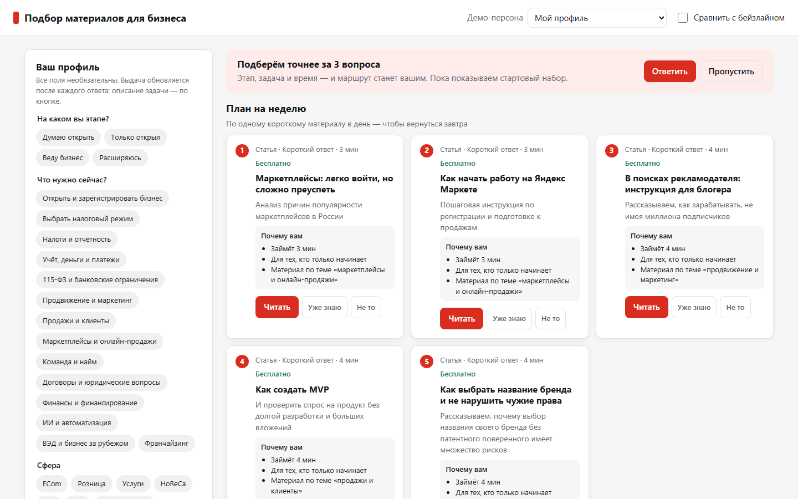

# Маршрут вместо ленты

Персональные рекомендации материалов «Альфа-Курса» для предпринимателей (Альфа-хакатон, трек 1). Человек
называет задачу — или ничего не называет — и за минуту получает короткий маршрут «понять → сделать →
углубиться» из 1497 статей, шаблонов, курсов, вебинаров, подкастов и калькуляторов платформы. У каждого
материала — «Почему вам» и кнопка следующего шага. Сервис работает на CPU, без ключей, GPU и внешних API;
модель — локальная multilingual-e5-small, режим виден в `/api/health`.



## Для жюри: что посмотреть за 5 минут

1. **Запустить** — `docker compose up --build`, открыть http://localhost:8000 и пройти 7 шагов
   [«Как проверить»](#как-проверить): холодный старт, подбор по задаче, сравнение с бейзлайном, «Уже знаю»,
   персоны с историей, уточнение для запроса вне каталога.
2. **Качество в цифрах** — раздел [«Качество»](#качество): ручная релевантность на отложенных профилях
   nDCG@10 0,499 против 0,250 у бейзлайна; полный отчёт — [`reports/eval.md`](reports/eval.md), подбор весов —
   [`reports/b06_final.md`](reports/b06_final.md).
3. **ML** — выбор модели эмбеддингов из пяти кандидатов, разметка стадии, уровня и задач с ручной проверкой на
   120 материалах — [`reports/b04_ml.md`](reports/b04_ml.md).
4. **Защита платного** — в артефакты и ответы API не попадает ни одного текста урока
   ([`reports/b08_acceptance.md`](reports/b08_acceptance.md)).
5. **Автоприёмка** — `python -m alfarec.eval.acceptance` проверяет сценарии A02–A10 через API и пишет отчёт с SHA
   коммита.

## Возможности

- **Без анкеты.** Сразу — стартовый набор и «План на неделю» из пяти коротких материалов. Карточка «Подберём
  точнее за 3 вопроса» необязательна; выдача обновляется после каждого ответа.
- **Маршрут, а не лента.** Первые шаги — понять и сделать (короткий ответ, шаблон, калькулятор), дальше —
  углубиться (курс, вебинар). В первых пяти — не меньше двух форматов, не больше одного платного материала
  и двух на одну тему.
- **Задача своими словами.** Описание задачи в свободной форме разбирается словарём задач. Если каталог не
  может ответить («Открыть автосервис в Казахстане»), сервис честно уточняет вариантами, а не подсовывает
  случайное совпадение.
- **«Почему вам».** Две-три причины из вкладов признаков ранжирования: задача, стадия, уровень, сфера,
  продолжение курса, время. Положительный вклад истории показывается всегда («По теме … из вашей истории»);
  если у материала нет других фактов, вторая причина — его формат. Кнопка шага соответствует формату: «Читать», «Скачать шаблон», «Посчитать»,
  «Начать курс», «Оформить Курс+».
- **История.** Пройденные курсы не предлагаются снова, незаконченный — продолжается, следующий курс подсказывают
  переходы «курс → курс» по записям других пользователей.
- **Обратная связь.** «Уже знаю» и «Не то» убирают материал и меняют выдачу сразу; события пишутся в журнал и
  переживают перезапуск.
- **Сравнение с бейзлайном** прямо в интерфейсе: слева наша выдача, справа подборка по теме и популярности.
- **Восемь демо-персон**, из них две — реальные пользователи по истории курсов из дампа.
- **Платное содержание защищено.** Платные и подписочные материалы — только название, публичное описание и
  ссылка; тексты уроков при сборке не читаются.
- **Деградация видна.** Без весов модели — TF-IDF, без индекса — бейзлайн; фактический режим в `/api/health`.

## Быстрый старт

Нужен Docker с Compose и запущенным Linux engine. Ключи, дамп, GPU и файл `.env` не нужны.

```sh
docker compose up --build
```

Страница — http://localhost:8000/, документация HTTP — http://localhost:8000/docs. Остановить —
`docker compose down`; журнал событий хранится в томе `events` между перезапусками, `docker compose down -v`
удаляет и его.

Сборка скачивает образ Python, пакеты (CPU-сборку PyTorch) и веса модели по фиксированной ревизии. Запущенный
сервис внешних API не вызывает, страница внешних ресурсов не грузит. Docker-проверка B10 подтверждает работу
режимов dense и TF-IDF после сборки в контейнере с `--network none`; среда и SHA — в
[протоколе A01](reports/b10_startup.md). Если скачать модель при сборке не удаётся, есть резервный образ без
нейросетевых библиотек (только TF-IDF):

```sh
docker build --build-arg WITH_ENCODER=0 -t alfarec-tfidf .
```

## Как проверить

1. Открыть http://localhost:8000/: сразу показан стартовый набор и встроенная карточка «Подберём точнее за
   3 вопроса»; её можно пропустить.
2. Выбрать в панели профиля задачу «Продвижение и маркетинг» и сферу «Услуги»: подборка меняется, у карточек
   есть «Почему вам» и кнопка следующего шага.
3. Включить «Сравнить с бейзлайном»: слева наша выдача, справа бейзлайн по теме и популярности.
4. Нажать «Уже знаю» на первой карточке: материал исчезает из выдачи сразу.
5. Выбрать демо-персону «ИП на маркетплейсах» или «Реальный пользователь 1»: пройденные курсы не предлагаются
   снова, над выдачей видна легенда персоны.
6. Проверить API: `GET /api/health` возвращает `status: ok`, `catalog_items: 1497`, `encoder: dense`.
7. Ввести в описание задачи «Открыть автосервис в Казахстане» и нажать «Подобрать»: вместо выдуманного
   совпадения появляется уточнение с вариантами и общая подборка.

## Качество

**Ручная релевантность.** Два участника независимо оценивали выдачи 0/1/2 по
[инструкции](docs/labeling.md), расхождения разобраны, согласованность на общих парах — каппа 1,0. Веса выбраны
только на 22 профилях `tune`; 14 профилей `holdout` для выбора не использовались. Неоценимые карточки
(`unjudgeable`) исключены из метрики и показаны в отчёте.

| Выборка | Вариант | nDCG@10 | Precision@5 | MRR |
|---|---|---:|---:|---:|
| holdout, 14 профилей | **Наша система** | **0,499** | **0,257** | **0,333** |
| holdout, 14 профилей | Бейзлайн по теме | 0,250 | 0,043 | 0,054 |
| tune, 22 профиля | Наша система | 0,571 | 0,382 | 0,503 |
| tune, 22 профиля | Бейзлайн по теме | 0,339 | 0,173 | 0,183 |

Честно: настройка весов улучшила `tune`, но на `holdout` немного уступила начальным весам (0,507); веса по
`holdout` не перевыбирались, это нарушило бы протокол. Выборка мала.

**Следующий курс по поведению** — 191 отложенный пользователь, последний курс скрыт, переходы построены по
другим пользователям:

| Метод | HitRate@5 | MRR |
|---|---:|---:|
| **Наша система с переходами между курсами** | **0,785** | **0,649** |
| Наша система без переходов (только содержание) | 0,675 | 0,225 |
| Популярность | 0,770 | 0,271 |

**Форма выдачи** на 36 тестовых профилях (без разметки):

| Метрика | Наша система | Бейзлайн |
|---|---:|---:|
| Форматов в топ-5, среднее | 2,08 | 1,94 |
| Разнообразие тем в топ-5 | 0,61 | 0,53 |
| Покрытие каталога топ-10 | 0,136 | 0,066 |
| Уточнение на профилях «уточнить» / лишние уточнения | 5 из 5 / 0 | 0 из 5 / 0 |
| Задержка ответа API, максимум на 36 профилях | 73 мс | — |

**Модель эмбеддингов** выбрана по редакторским связям платформы «смотрите также» (3880 связей, разбиение по
источнику на tune/holdout) с ограничениями 500 МБ и 150 мс на CPU:

| Модель | Tune nDCG@10 | Holdout nDCG@10 | CPU p95, мс | Размер, МБ |
|---|---:|---:|---:|---:|
| TF-IDF | 0,133 | 0,119 | 12,6 | 24 |
| multilingual-e5-small — **выбрана** | 0,130 | 0,143 | 15,5 | 493 |
| USER | 0,130 | 0,142 | 35,1 | 503 |
| multilingual-e5-base | 0,131 | 0,144 | 38,7 | 1135 |

Превосходство нейросети над TF-IDF не заявляем: на tune TF-IDF чуть сильнее. **Разметка материалов:**
стадия, уровень и задачи почти не размечены в данных; восстанавливаем правилами, классификатором и локальной
Qwen2.5-7B. На 120 материалах, размеченных вручную вслепую, accuracy стадии выросла с 0,575 до 0,725, задач —
с 0,475 до 0,525; LLM для уровня отключена, потому что ухудшила macro-F1.

Пересчитать офлайн-оценку: `python -m alfarec.eval` (нужны входы `data/handoff/`, см. ниже). План A/B-теста
после внедрения — [`docs/ab-test.md`](docs/ab-test.md), он не запускался.

## Архитектура

```text
дамп PostgreSQL (вне git) ─► alfarec/pipeline ─► artifacts/ (в git) ─► FastAPI alfarec/api ─► страница alfarec/web
 читается pgdumplib,         каталог без текстов   catalog.parquet,       рекомендации, события,   HTML/CSS/JS
 без СУБД                    уроков; на GPU —      ml/ (векторы, метки,   мета, карточки           без сборки
                             векторы, метки, граф  граф), weights.json,
                                                   personas.json
```

Ранжирование: кандидаты (близкие по запросу, материалы задач профиля, соседи истории, курсы) → линейный скоринг
из 12 интерпретируемых признаков с весами из `artifacts/weights.json` → переранжирование MMR с квотами
форматов, тем и платного → объяснения из вкладов признаков. Всё офлайн-тяжёлое (векторы, метки, граф соседей)
считается заранее; на CPU кодируется только текст запроса.

| Каталог | Что внутри |
|---|---|
| `alfarec/pipeline/` | чтение дампа, каталог, персоны, отчёт о покрытии таксономии, переходы курсов, сравнение моделей, разметка, упаковка ML |
| `alfarec/recsys/` | контракты, каталог, индекс поиска, ранжирование, понимание текста, бейзлайн, объяснения и следующий шаг, веса |
| `alfarec/api/` | FastAPI, схемы ответов, журнал событий |
| `alfarec/web/` | страница интерфейса без сборки |
| `alfarec/eval/` | тестовые профили, офлайн-оценка, формы и сведение ручной разметки, подбор весов, автоприёмка, расчёт A/B |
| `artifacts/` | каталог 1497 материалов (метаданные и описание до 300 символов), ML-артефакты, веса, персоны |
| `presentation/` | сборщик PDF-презентации из отчётов и живого API |
| `reports/` | отчёты оценки, ML, приёмки |

### HTTP API

| Метод | Назначение |
|---|---|
| `GET /api/health` | Готовность: число материалов, `recommender: ranking`, `encoder: dense` или `tfidf`; при недоступном индексе — `degraded` и `baseline` |
| `GET /api/meta` | Стадии, уровни, задачи, сферы, форматы и бюджеты времени для онбординга |
| `GET /api/personas` | Демо-персоны с профилем и историей |
| `POST /api/recommendations` | Профиль, необязательный `user_id`, `mode` (`ours` / `baseline`), `limit` → подборки и следующий шаг |
| `POST /api/events` | Событие (`view`, `known`, `dislike` и др.); следующий запрос того же `user_id` его учитывает |
| `GET /api/items/{item_id}` | Публичная карточка материала |
| `GET /`, `GET /docs` | Страница интерфейса и Swagger |

Если каталога нет, health отвечает `status: degraded`, а рекомендации — понятной ошибкой 503.

## Переменные окружения и порты

Все переменные необязательны; пример — [`.env.example`](.env.example), рабочих ключей и паролей нет.

| Переменная | По умолчанию | Назначение |
|---|---|---|
| `PORT` | `8000` | Порт на хосте; сервис доступен только с `127.0.0.1`. Внутри контейнера — 8000 |
| `ENCODER` | `auto` | `auto` — упакованная модель, без неё TF-IDF; `tfidf` — явный резерв; `dense` — требовать модель |
| `PLATFORM_BASE_URL` | `https://kurs.alfabank.ru` | Адрес платформы в ссылках материалов; пути страниц берутся из слагов дампа |
| `CATALOG_PATH`, `PERSONAS_PATH`, `EVENTS_PATH` | файлы в `artifacts/` и `data/events/events.jsonl` | Пути для запуска без Docker |
| `MODEL_PATH`, `ML_PATH`, `WEIGHTS_PATH` | `artifacts/ml/model`, `artifacts/ml`, `artifacts/weights.json` | Модель, ML-артефакты и веса для запуска без Docker |

API читает `artifacts/weights.json` при старте. Если стандартного файла нет — начальные веса; явно указанный
отсутствующий файл, несовместимый каталог или неверные значения переводят API в `degraded/baseline`.

## Зависимости

- `requirements.txt` — runtime с точными версиями: FastAPI, Uvicorn, Pydantic, PyYAML, PyArrow, NumPy, SciPy,
  scikit-learn.
- `requirements-encoder.txt` — runtime CPU-образа с моделью: плюс PyTorch CPU, Transformers, sentence-transformers.
- `requirements-dev.txt` — runtime и инструменты: pytest, Ruff, pgdumplib для чтения дампа.
- `requirements-ml.txt` — GPU-окружение офлайн-подготовки B04; в образ не входит.

## Входные данные и пересборка артефактов

Сервису нужны только закоммиченные `artifacts/`. Дамп `alfa_course_hackathon.backup` передаётся вне репозитория и
кладётся в `data/` (каталог исключён из git); PostgreSQL не нужен.

```sh
python -m alfarec.pipeline.build_catalog
python -m alfarec.pipeline.coverage
python -m alfarec.pipeline.build_personas
python -m alfarec.pipeline.export_handoff
python -m alfarec.pipeline.build_transitions
```

Команды по порядку пишут каталог и текст для эмбеддингов, [отчёт о покрытии таксономии](reports/taxonomy_coverage.md),
персоны, входы для ML и оценки в `data/handoff/` ([манифест](reports/b02_handoff.md)) и счётчики переходов между
курсами без пользователей. Тесты сверяют артефакты с ожидаемым составом, а при наличии дампа — побайтную
воспроизводимость и отсутствие текстов уроков. GPU-конвейер модели и меток — в
[«Воспроизведении» B04](reports/b04_ml.md#воспроизведение), подбор весов — в [итоге B06](reports/b06_final.md).

## Ограничения

- Ручная оценка небольшая: 14 отложенных профилей, профили тестового набора использовались в разработке ранее.
  Абляции (вклад отдельных признаков) не измерены. Бизнес-эффект не измерен — для этого план A/B.
- Офлайн-оценка следующего курса — snapshot-диагностика: популярность взята из полного снимка каталога, это не
  временной backtest.
- Метки стадии и задач неточны: accuracy 0,725 и 0,525 на ручной проверке.
- Объяснения показывают три сильнейших вклада, но вклад истории после подбора весов слабее задачи, сферы и
  стадии; поэтому он занимает третье место принудительно. Порядок карточек и score от этого не меняются —
  проверено воспроизведением всех оценённых списков B06.
- Профиля пользователя в данных нет: персоны и тестовые профили составлены командой; «реальные пользователи»
  знают только историю курсов.
- Аккаунтов нет: `user_id` — анонимный идентификатор из браузера. Сервис рассчитан на локальный показ, а не на
  публичный доступ. События демо-персон хранятся в памяти и сбрасываются перезапуском.
- Популярность есть только у курсов и калькуляторов, поэтому стартовый набор без профиля состоит в основном из них.
- Смысл флага `IsClosed` у вебинаров и части курсов не описан; они считаются бесплатными.
- Swagger на `/docs` грузит интерфейс с CDN и без сети не откроется; API и страница от сети не зависят.
- Если журнал событий повреждён, нечитаемые строки пропускаются с предупреждением в логе.

## Внешние API

Нет. Сервис не обращается к внешним API и моделям, ключи не нужны. Модель
[multilingual-e5-small](https://huggingface.co/intfloat/multilingual-e5-small) скачивается при сборке образа по
фиксированной ревизии и работает локально. [Qwen2.5-7B-Instruct](https://huggingface.co/Qwen/Qwen2.5-7B-Instruct)
использовалась офлайн на GPU для разметки; в сервис не входит. Ссылки ведут на страницы платформы, их открывает
браузер пользователя.

## Разработка

Python 3.12:

```sh
python -m venv .venv
```

На Windows активировать `.venv\Scripts\Activate.ps1`, на Linux — `source .venv/bin/activate`. Затем:

```sh
python -m pip install -r requirements-dev.txt
python -m uvicorn alfarec.api.main:app --host 127.0.0.1 --port 8000
```

Так сервис работает на TF-IDF. Режим модели локально: установить `requirements-encoder.txt` и выполнить
`python -m alfarec.pipeline.fetch_encoder`.

Проверки (те же в CI на Windows и Ubuntu; сборка и запуск Docker со страницей, выдачей и записью события — на
Ubuntu):

```sh
python -m ruff format --check alfarec tests
python -m ruff check alfarec tests
python -m pytest
pwsh -NoProfile -File scripts/check.ps1
pwsh -NoProfile -File scripts/test-checks.ps1
```

Отдельная Docker-приёмка (нужны Docker, Compose и PowerShell 7):

```sh
pwsh -NoProfile -File scripts/check-docker.ps1
```

Она создаёт отдельный Compose-проект на порту 18000, проверяет dense, запуск без сети, сохранение обычных событий
при пересоздании контейнера с тем же томом, сброс демо-персон и явный TF-IDF. Удаляет только собственные тестовые
контейнеры и том.

Презентация: `python presentation/build.py` собирает `dist/alfa-course-recommendations.pdf` (вне git) из отчётов и
ответов API на текущем коммите; нужен Edge или Chrome (`--browser`), `--skip-pdf` — только HTML. Для сдаваемого PDF
сначала установить модель: примеры берутся в том режиме, который загрузил сервис.

## Материалы

| Где | Что |
|---|---|
| [`reports/eval.md`](reports/eval.md), [`reports/b06_final.md`](reports/b06_final.md) | офлайн-оценка, ручная релевантность, подбор весов |
| [`reports/b04_ml.md`](reports/b04_ml.md), [`reports/label_check.md`](reports/label_check.md) | выбор модели, разметка и её проверка, CPU-поставка |
| [`reports/b08_acceptance.md`](reports/b08_acceptance.md) | объяснения, следующий шаг, защита платного |
| [`docs/labeling.md`](docs/labeling.md), [`docs/ab-test.md`](docs/ab-test.md) | инструкция разметки, план A/B-проверки |
| [`docs/specs/b01-contracts.md`](docs/specs/b01-contracts.md) | контракты и значения полей |
| [`docs/specs/2026-11-13-recommender-tz.md`](docs/specs/2026-11-13-recommender-tz.md) | полное ТЗ — целевой продукт; не всё в нём реализовано |
| [`docs/development.md`](docs/development.md), [`docs/development-rules.md`](docs/development-rules.md), [`docs/tasks/README.md`](docs/tasks/README.md) | подготовка клона, правила команды, очередь задач |
| [`docs/submission.md`](docs/submission.md) | комплект, срок и порядок сдачи |
