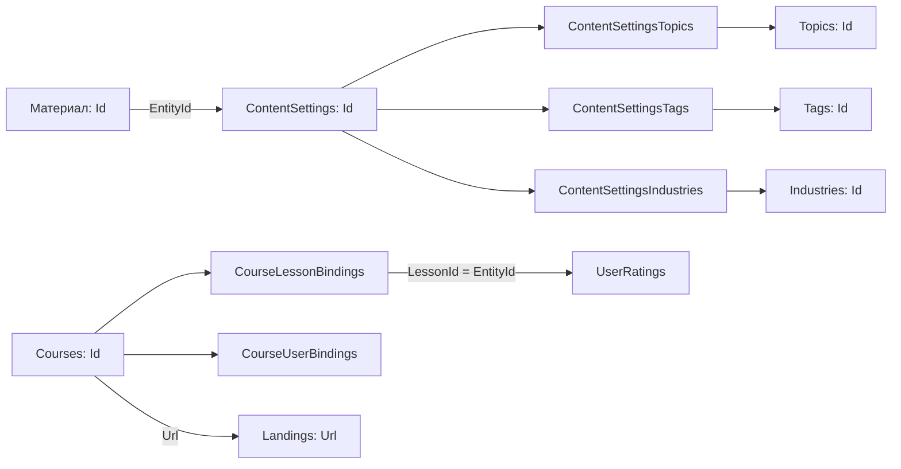

# Данные B02: схема и передача

Описание дополняет [DATA.md](DATA.md) и реализацию [PR #7](https://github.com/ib1te1/alfa-hack-and-change/pull/7), версия `4a7922e`. Исполнитель B02 — `enioZz95`; эта документация описывает существующий результат и не вводит вторую реализацию каталога.

## Область описания

Схема публичного каталога подтверждается кодом `alfarec/recsys/catalog.py` и закоммиченным `artifacts/catalog.parquet`. Карта исходных таблиц описывает поля и связи, используемые адаптером B02. Это не полный DDL исходной базы: типы PostgreSQL, внешние ключи, индексы и ограничения 62 таблиц без оригинального дампа здесь не подтверждены.

Дамп организаторов и промежуточный текст индекса передаются вне Git. Их нельзя восстановить из публичного каталога: в нём нет полных текстов, пользовательских взаимодействий и редакторских связей. Синтетический тестовый дамп не заменяет исходный.

## Артефакты

| Файл | Назначение | Хранение |
|---|---|---|
| `data/alfa_course_hackathon.backup` | Исходный custom-format `pg_dump` | Вне Git |
| `artifacts/catalog.parquet` | Метаданные и публичные карточки материалов | В приватном репозитории |
| `data/processed/index_text.parquet` | Текст для эмбеддингов и офлайн-разметки | Вне Git |

Готовый каталог уже находится в ветке B02: для его чтения исходный дамп не нужен. Дамп нужен для пересборки, текста эмбеддингов, редакторских связей и проверки поведения. Создавать пустой или искусственный файл с именем оригинала не требуется.

## Публичный каталог

Одна строка — один материал. Каноническая схема задана `CATALOG_SCHEMA` в [catalog.py](../../alfarec/recsys/catalog.py); `load_catalog()` дополнительно проверяет каждую строку моделью `Item`. `item_id` должен быть уникален во всём каталоге; совпадение ID между типами также считается коллизией.

| Поле | Тип Arrow | Допускает null | Значение и источник |
|---|---|---|---|
| `item_id` | string | Нет | `Id` материала, для калькулятора — `CalculatorPages.Id` |
| `item_type` | string | Нет | article, document, course, webinar, podcast, glossary, calculator |
| `format` | string | Нет | quick_answer, guide, template, tool, course, recording, podcast |
| `title` | string | Нет | Очищенный заголовок, до 200 символов |
| `summary` | string | Нет | Очищенное описание, до 300 символов; пустая строка возможна |
| `duration_min` | int32 | Да | Продолжительность в минутах; null означает неизвестную длительность |
| `access` | string | Нет | free, subscription или paid по правилам B02 |
| `price_rub` | int32 | Да | Цена курса, платного подкаста либо месячного тарифа подписки; null не означает автоматически бесплатный доступ |
| `url` | string | Нет | Базовый адрес платформы, путь по типу и слаг `Url` |
| `topics` | list[string] | Нет | Нормализованные значения Topics через ContentSettings |
| `raw_tags` | list[string] | Нет | Нормализованные значения Tags через ContentSettings |
| `raw_industries` | list[string] | Нет | Нормализованные значения Industries; могут содержать метки опыта, не только сферу |
| `subject` | string | Да | Рубрика статьи либо тип документа |
| `published_at` | timestamp[us, UTC] | Да | Published, у вебинара — StartsAt с резервным Published |
| `popularity` | float64 | Да | Число записей на курс; у калькулятора — число оценок как косвенный показатель использования |
| `completion_rate` | float64 | Да | Доля записей со Status=2 среди неудалённых записей на курс |
| `rating` | float64 | Да | Средняя оценка уроков курса либо страницы калькулятора, значения 1–5 |

Для списков используется пустой список при отсутствии меток. Вложенный тип списка в физическом Parquet называется `element`, в Arrow-константе — `item`; это имена дочернего поля, а не разные бизнес-поля. Строки дат приводятся к UTC при сериализации; дата без часового пояса не должна получать выдуманное смещение.

Поля `index_text`, полные тексты, пользовательские ID и события в каталог не входят. Стадия бизнеса, уровень и детальные задачи отсутствуют: они создаются отдельно в B04 и связываются через `item_id`.

## Текст индекса

Схема `INDEX_TEXT_SCHEMA` задана в [build_catalog.py](../../alfarec/pipeline/build_catalog.py). Сам локальный файл индекса при этой проверке недоступен; подтверждён контракт записи, а не его содержимое.

| Поле | Тип Arrow | Допускает null |
|---|---|---|
| `item_id` | string | Нет |
| `item_type` | string | Нет |
| `access` | string | Нет |
| `index_text` | string | Нет |

Ожидается одна строка на каждый материал каталога, соединение по `item_id` один-к-одному. Формируется заголовок, описание, дополнительные поля и до 4000 символов тела свободно доступного материала. Для платного и подписочного содержания разрешён только подтверждённый публичный текст; допустимость отдельных источников проверяется отдельно от схемы, см. раздел о доступе ниже.

## Карта чтения исходной БД

Адаптер [dump_reader.py](../../alfarec/pipeline/dump_reader.py) читает namespace `public`, извлекает имена колонок из `COPY` и оставляет значения текстовыми: `t`/`f`, строки чисел и дат, `None` вместо SQL NULL. Наличие поля в строке Python не подтверждает тип или ограничение PostgreSQL.

Ниже перечислены поля, используемые существующим кодом, а не все колонки таблиц. Материалы фильтруются по ссылке `StatusId` на статус «Опубликовано» и признаку `IsDeleted`. Для справочников используется фильтр неудалённости там, где вызывается `live(..., with_status=False)`; `Statuses` и `CourseTypes` читаются напрямую без него. Там, где адаптер получает `row.get(...)`, отсутствие колонки может иметь значение по умолчанию и не доказывает её наличие в исходной схеме.

| Таблицы | Читаемые поля и роль |
|---|---|
| `Statuses` | Id, Title — поиск ID статуса публикации |
| `Articles` | Id, StatusId, IsDeleted, Title, Description, CardDescription, Url, Published, Duration, SubjectId, IsClosed, ContentHeadings — карточка статьи и выбор тела |
| `ArticleSubjects` | Id, Title, IsDeleted — значение subject по Articles.SubjectId |
| `Documents` | Id, StatusId, IsDeleted, Title, Description, Url, Published, TypeId — карточка документа |
| `DocumentTypes` | Id, Title, IsDeleted — значение subject по Documents.TypeId |
| `Courses` | Id, StatusId, IsDeleted, Title, Description, Url, Published, Duration, Cost, TypeId, DescriptionAdditional, Target — карточка, доступ и дополнительные тексты |
| `CourseTypes` | Id, Title — тип курса: открытый, по подписке, платный |
| `CourseSubscriptions` | CourseId — наличие подписочного доступа для курса |
| `CourseInfoBindings` | CourseId, Title, Description; Order и Id для порядка — дополнительные сведения о курсе |
| `Landings` | StatusId, IsDeleted, Url, Description, LandingDescription, InfoBindings — опубликованный лендинг, соединяется с курсом по Url |
| `Webinars` | Id, StatusId, IsDeleted, Title, Description, DescriptionExt, Url, StartsAt, Published, Duration — карточка записи вебинара |
| `Podcasts` | Id, StatusId, IsDeleted, Title, Description, DescriptionExt, Url, Published, Duration, Cost — карточка и доступ |
| `PodcastDetails` | PodcastId, Title, Description; Order и Id для порядка — дополнительные сведения |
| `PodcastSubscriptions` | PodcastId — признак подписочного подкаста |
| `Glossary` | Id, StatusId, IsDeleted, Title, Description, Url, Published, Duration — короткий ответ |
| `CalculatorPages` | Id, StatusId, IsDeleted, Title, Description, Url, Published — рекомендуемая страница калькулятора |
| `ArticleEmbedItems` | ArticleId, HtmlContent; Order и Id для порядка — тело статьи |
| `DocumentEmbedItems` | DocumentId, HtmlContent; Order и Id для порядка — тело документа |
| `GlossaryEmbedItems` | GlossaryId, HtmlContent; Order и Id для порядка — тело определения |
| `CalculatorPageEmbedItems` | CalculatorPageId, HtmlContent; Order и Id для порядка — текст страницы инструмента |
| `ContentSettings` | Id, EntityId, IsDeleted — полиморфная привязка меток к материалу |
| `ContentSettingsTopics` | ContentSettingsId, TopicId; Order и Id для порядка — связь с темой |
| `ContentSettingsTags` | ContentSettingsId, TagId; Order и Id для порядка — связь с тегом |
| `ContentSettingsIndustries` | ContentSettingsId, IndustryId; Order и Id для порядка — связь со сферой или витринной меткой |
| `Topics`, `Tags`, `Industries` | Id, Title, IsDeleted — исходные справочники меток |
| `Subscription` | Id, IsDeleted — неудалённые записи справочника подписок; активность и срок действия этим фильтром не устанавливаются |
| `SubscriptionTariffs` | SubscriptionId, IsMain, Cost, DiscountCost — цена основного тарифа |
| `CourseUserBindings` | CourseId, Status, IsDeleted — количество записей и завершений курса; пользовательские поля B02 не экспортирует |
| `CourseLessonBindings` | CourseId, LessonId, IsDeleted — отнесение оценки урока к курсу |
| `UserRatings` | EntityId, Value, IsDeleted — оценки уроков и страниц калькуляторов |

`InfoBindings` лендинга разбирается как JSON-массив с Title, Description и Order. B02 запрашивает 32 таблицы из списка `TABLES`; `Lessons` и `LessonEmbedItems` в этот список не входят. `RecommendedItems`, `DocumentBindings` и подробный журнал прохождения для ML/оценки нужно читать отдельно из оригинального дампа; их физические колонки здесь не описываются без проверки источника.

Логические соединения адаптера, не утверждения о физических FOREIGN KEY:



## Доступ и условия проверки

Текущая реализация относит статьи к подписочным по `IsClosed`, курсы — по Cost, CourseTypes и CourseSubscriptions, подкасты — по Cost и PodcastSubscriptions. `IsPublic` статьи не участвует в вычислении доступа. В карточке B02 это объяснено как скрытие из ленты при сохранении открытой страницы; без исходного описания поля и проверки публичной страницы такую семантику нельзя вывести только из названия флага.

Для приёмки приватности нужны отдельные подтверждения:

1. Зафиксировать смысл IsPublic и IsClosed для каждого типа. Наличие строки в дампе или статус публикации сами по себе не означают разрешение индексировать подробный текст.
2. Подтвердить, какие DescriptionAdditional, ContentHeadings, CourseInfoBindings и PodcastDetails действительно видны без оплаты. В версии `4a7922e` они попадают в `extra_text`; запрет тела для `access != free` не исключает эти дополнительные поля. Нужен явный список разрешённых публичных источников, а не только отсутствие чтения уроков.
3. В проверке совпадений с уроками исключать из эталона открытых статей черновики и удалённые записи. Сравнение только по IsClosed недостаточно для подтверждения опубликованности эталонного текста.
4. Проверить путь `/webinars/<слаг>` и неоднозначный `Courses.IsClosed`, уже отмеченные в [POLISH.md](../tasks/POLISH.md).

Эти условия не означают, что утечка в реальном каталоге обнаружена: без оригинальных данных и правил доступа такой вывод не сделан. Они отделяют корректность схемы от доказательства публичности содержания.

## Подтверждённый снимок

Проверен артефакт из `4a7922e`:

- SHA-256 `catalog.parquet`: `c63265dacd9d9ccf54765a9b6157d491d17223c2d7bacc860735091c0af881ee`.
- 1497 уникальных материалов: 838 статей, 247 документов, 33 курса, 13 вебинаров, 8 подкастов, 351 определение, 7 калькуляторов.
- Доступы: 1483 free, 13 subscription, 1 paid.
- 109 тестов Python прошли на Windows/Python 3.12.14; проверка пересборки на оригинальном дампе пропущена. При тесте чтения синтетического дампа наблюдалось предупреждение очистки временного файла библиотеки pgdumplib на Windows; это не проверка реального дампа.
- Отчёт `reports/taxonomy_coverage.md` воспроизводится из готового каталога. CI исходного PR #7 зелёный на Windows и Ubuntu.

Более поздний [PR #13](https://github.com/ib1te1/alfa-hack-and-change/pull/13) меняет очистку текста и бинарный каталог; его контрольная сумма будет другой. Схема этого документа относится к B02, а не автоматически к любой будущей версии артефакта.

## Передача для B04

1. Использовать проверенный коммит каталога и соответствующие `requirements*.txt`; записать SHA артефакта и число строк.
2. Получить от исполнителя B02 исходный дамп вне репозитория либо согласованную передачу индекса и редакторских связей. Полный дамп не публиковать и не отправлять во внешние сервисы.
3. После размещения оригинала в `data/` выполнить команды в корне этой ветки:

   ```sh
   python -m alfarec.pipeline.build_catalog
   python -m alfarec.pipeline.coverage
   python -m pytest tests/test_catalog_artifact.py
   ```

4. Сверить состав, ID и версию каталога с индексом. Для той же версии кода, зависимостей и дампа ожидается совпадение контрольной суммы; для исправленного текста нужен новый связанный набор артефактов, а не смешение старых и новых файлов.
5. Для эмбеддингов, ML-меток, редакторского сравнения и графа поведения использовать только разрешённые поля и те же ID. При отсутствии индекса доступно чтение заголовков и summary из готового каталога, но оно не заменяет предусмотренную ТЗ подготовку полного разрешённого текста.
